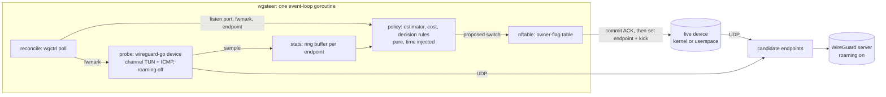

# Design

`wgsteer` keeps one WireGuard client peer on the best of several equivalent UDP endpoints. Every candidate (a relay `ip:port`, `[ipv6]:port`, or the server's own address) reaches the same server `ip:port`, so the session keys stay valid across a switch and a switch needs no handshake.

The work has three parts:

1. **Probe** every candidate through a separate WireGuard identity (an in-process wireguard-go device with roaming disabled).
2. **Score** the candidates and decide when to switch ([scoring.md](scoring.md)).
3. **Switch** the live device's peer endpoint, guarded by an nftables deny-list against roaming back ([switching.md](switching.md)).

## Architecture

## Packages

| Package | Role |
|---|---|
| `cmd/wgsteer` | Flag parsing via `daemon.ParseFlags`, exit codes |
| `cmd/wgsteer-replay` | Replays recorded probe samples through `internal/policy` with any flags, endpoint subset and synthetic faults; the engine behind `tools/tune.py` ([scoring.md](scoring.md#tuning-on-recorded-data)) |
| `internal/endpoints` | Endpoint list parsing and normalization (`netip.AddrPort`, unmapped, no zones) |
| `internal/probecfg` | Probe identity (xplatform UAPI `set` format), validation, the creating `IpcSet` text |
| `internal/probe` | wireguard-go device over a channel TUN, ICMP/ICMPv6 echo, the probe's own UDP bind, slot scheduler, session validity |
| `internal/stats` | Per-endpoint sample ring and the recency-weighted estimator |
| `internal/policy` | Cost model, gated comparison, net-time accumulators, decision rules; pure (all time from the caller) |
| `internal/wgdev` | wgctrl wrapper: read the device, set the endpoint with `UpdateOnly`, kick |
| `internal/nftable` | Owner-flag table on one lasting netlink connection, atomic chain rebuilds, counters, read-back |
| `internal/status` | Immutable, JSON-tagged status snapshot and its text rendering |
| `internal/daemon` | Event loop, lifecycle, reconcile, switch procedure, logging, watchdog |

## Single event loop

One goroutine owns all state; nothing else touches the engine, the nft manager, the device client or the probe. `Manager` and `Client` are not safe for concurrent use. The loop `select`s on:

| Event | Handling |
|---|---|
| Slot timer | Alternates between *begin slot* and *finish slot*. Slots sit on a fixed grid (`base + n×--probe-interval`); a stall skips missed grid points instead of bunching them |
| Probe reply channel | `Scheduler.Match` (seq, nonce, endpoint id); fed by the TUN `Write` path |
| Reconcile ticker (`--reconcile-interval`) | Read the device, detach/attach, fwmark and listen-port changes, nft retry, counters, switch verification, re-assert/alias, stale-handshake check |
| Summary ticker (`--summary-interval`, 0 disables) | One `summary` line per endpoint from the snapshot |
| Signals | `SIGHUP` reload, `SIGUSR1` dump, `SIGUSR2` debug toggle, `SIGTERM`/`SIGINT` stop |

**Begin slot:** read the probe's `IpcGet` state, compute session validity, `Scheduler.Begin` picks the next endpoint round-robin, `Retarget`, `Send` one echo, arm the timer for the slot deadline (`--probe-timeout`). A failed retarget or send discards the slot (no sample, no loss).

**Finish slot:** drain pending replies, `Scheduler.Finish`, record the sample (`Record`) or an invalid slot (`RecordInvalid`), then `Engine.Tick`. A proposed switch is executed in the same iteration ([switching.md](switching.md#switch-procedure)).

**Tick proposes, Commit applies:** `Engine.Tick` only proposes; the selection changes only when the daemon calls `Engine.Commit` after the switch ran (or was simulated in dry-run). A switch that is aborted (failed nft commit) or deferred (device detached) is not committed, so all accumulators stay and a later tick proposes it again.

After every handled event except a probe reply, the loop rebuilds and publishes the status snapshot through an `atomic.Pointer`; readers (SIGUSR1 dump, summary) use only the snapshot ([observability.md](observability.md#status-snapshot)). The loop also stamps the watchdog heartbeat on every iteration.

## Lifecycle

```mermaid
stateDiagram-v2
  [*] --> waiting_device: inputs loaded
  waiting_device --> running: device and managed peer valid; nft table created; probe started
  running --> detached: device or peer missing / read error
  detached --> running: device back and re-validated (rules re-applied)
  running --> stopping: SIGTERM / SIGINT
  detached --> stopping: SIGTERM / SIGINT
  waiting_device --> stopping: SIGTERM / SIGINT
  stopping --> [*]: table deleted, probe closed
```

The snapshot `daemon.state` values are `waiting-device`, `running`, `detached`, `stopping`.

**Start**

1. Startup report header (`starting`, `config`), then `privileges` (uid, euid, gid, effective capabilities). Without `CAP_NET_ADMIN` in the effective set, startup fails here (step `privileges`) instead of later with a bare "operation not permitted".
2. Load the endpoint list (`endpoint` lines) and the probe config; validate `--probe-addr`/`--target` against it.
3. Open wgctrl, then poll the device every `--reconcile-interval` until it exists with a key and peers. "Device not found" and "not configured" wait; any other read error is a startup failure. The probe's peer key must be a peer of the device and the probe key must differ from the device key. During the wait, `SIGHUP` reloads the list, `SIGUSR1`/`SIGUSR2` work, and `SIGTERM`/`SIGINT` exit cleanly.
4. Selection = the device's endpoint if it is listed; otherwise none (all listed candidates are denied until the startup switch, [switching.md](switching.md#aliases)).
5. Create the owner-flag nft table and apply the initial deny-list (skipped in dry-run).
6. Start the probe with the device's fwmark and the first listed endpoint.
7. `ready` with the eligibility ETA (`--min-samples` × endpoints × `--probe-interval`), then enter the loop.

Every failed step logs `startup failed` with `step` (`privileges`, `endpoints`, `probe config`, `wgctrl`, `device`, `policy`, `nft`, `probe`) and exits 1.

**Stop (`SIGTERM`/`SIGINT`):** delete the table explicitly, close the probe and the wgctrl client. The device keeps its current endpoint. Exit 0.

**Unexpected exit (SIGKILL, panic, OOM):** the kernel removes the owner-flag table with the process's netlink socket. The device keeps its endpoint and roams like plain WireGuard until the service manager restarts the daemon.

**Hang:** the watchdog goroutine checks the heartbeat every `--watchdog`/4 (at least 10 ms). If the last beat is older than `--watchdog`, it logs `watchdog: event loop stalled, exiting` with all goroutine stacks and exits 3. The report is best-effort: the loop may be stalled on the same blocked stderr, so the exit waits at most 1 s for it. The exit closes the socket, which removes the table.

**Detached:** when a reconcile read fails or the device/peer is gone, the daemon keeps probing and scoring, leaves nft alone, and defers proposed switches (no commit). On reattach it re-validates, marks the rules dirty and re-applies them on the same reconcile tick; a deferred switch runs on the next tick.

**Reload (`SIGHUP`):** re-read the endpoint list only (a probe-config change needs a restart). Endpoints still listed keep their history, accumulators and restore level; new ones start empty; list position (order bias) follows the new file. The deny-list is rebuilt and a tick runs at once; if the selection was removed, that tick proposes a `reload` switch that ignores the cooldown. A list that fails to parse is rejected and the old list kept.

## Dry-run

`--dry-run` probes, scores and logs decisions but never writes the device and creates no nft table:

- `nft table skipped reason=dry-run` in the startup report; `nft.enabled=false` in the snapshot;
- proposed switches are logged as `would switch` and committed to the engine only, so the simulated selection moves on;
- reconcile still reads the device (detach/attach, fwmark), but never re-asserts; a device endpoint that differs from the simulated selection is logged at debug.

Dry-run still needs `CAP_NET_ADMIN`: wgctrl reads use netlink.

## Privileges

wgsteer needs exactly one capability, `CAP_NET_ADMIN`, and runs fine as a non-root user that holds it. Measured with the real binary in the namespace topology: with only `CAP_NET_ADMIN` (effective, permitted, bounding and ambient sets, `no_new_privs`, noroot securebits) startup, the owner-flag table, the fwmark copy, switches with the kick, re-asserts, signals and the clean stop all work; with no capabilities, `CAP_NET_RAW`, or `CAP_NET_BIND_SERVICE` + `CAP_DAC_OVERRIDE` instead, startup fails. The namespace suite runs every daemon this way (`DAEMON_PRIVILEGES` in `tests/integration/topology.py`), so a change that needs more fails there.

| Operation | Kernel check |
|---|---|
| WireGuard genetlink, reads (`--dry-run` too) and writes (endpoint, kick) | `CAP_NET_ADMIN` (`GENL_UNS_ADMIN_PERM`) |
| nftables, every message including listing | `CAP_NET_ADMIN` |
| `SO_MARK` on the probe sockets (device has a fwmark) | `CAP_NET_ADMIN` (or `CAP_NET_RAW` since Linux 5.17) |
| Probe UDP sockets, channel TUN, ICMP inside the tunnel | none (no raw sockets, no `/dev/net/tun`) |
| Probe `listen_port` below 1024 in the probe config | `CAP_NET_BIND_SERVICE`; leave it unset (random port) instead |
| Linux >= 5.12 | `NFT_TABLE_F_OWNER`; without it startup fails with `ErrNoOwnerSupport` (no unowned fallback) |

- Capabilities are checked in the user namespace that owns the device's network namespace. `CAP_NET_ADMIN` held only in a child user namespace (some rootless containers) shows up as effective but every netlink call fails with `EPERM`; the startup error says so.
- `CAP_NET_ADMIN` is still full network control, including reading the live device's private key through genetlink. Running as a non-root user removes filesystem, process and module powers, not network ones.
- **Userspace devices (wireguard-go):** wgctrl talks to `/var/run/wireguard/<dev>.sock`, which wireguard-go creates as `srwx------` for its own uid. That is a file permission, not a capability: run wgsteer as the same uid as wireguard-go (`CAP_DAC_OVERRIDE` would also pass, but is not worth granting). The socket cannot be opened up afterwards: wireguard-go watches it with inotify and shuts down on any attribute change, so a `chmod`/`chown` kills the device. A daemon that cannot write the socket fails with `connect: permission denied` plus a hint. Kernel devices have no such constraint.
- Files: the service user must read the probe config (it holds a private key: `0640 root:wgsteer`) and the endpoint list (re-read on `SIGHUP`). The daemon writes no files.

**Service managers**

- **systemd:** `User=wgsteer`, `AmbientCapabilities=CAP_NET_ADMIN`, `CapabilityBoundingSet=CAP_NET_ADMIN`, `NoNewPrivileges=yes` (the [README](../README.md#systemd) unit; the same set the measurement above used).
- **OpenWrt procd:** `procd_set_param user` alone is not enough: without a jail procd drops to the user with plain `setgid`/`setuid`, which clears every capability, and the daemon fails at the `privileges` step. Capabilities are applied only through ujail ([procd `service/instance.c`](https://github.com/openwrt/procd/blob/master/service/instance.c)). Two options:
  - ujail (package `procd-ujail`): `procd_add_jail wgsteer`, `procd_set_param capabilities /etc/capabilities/wgsteer.json` (`CAP_NET_ADMIN` in `bounding`, `effective`, `permitted`, `inheritable` and `ambient`), `procd_set_param user wgsteer`, `procd_set_param group wgsteer`, `procd_set_param no_new_privs 1`. The jail must stay in the host network namespace and mount the probe config and endpoint list read-only.
  - File capability: `setcap cap_net_admin=ep` on the binary (mode `0750 root:wgsteer`) plus `procd_set_param user`, without `no_new_privs` (it blocks file capabilities). Needs `setcap` at install time and xattr support on the filesystem holding the binary.
  - Not verified on a router yet: whether the image ships `/sbin/ujail`, the jail mounts the binary needs, and xattr support of the overlay.

## Clocks

| Consumer | Clock | Reason |
|---|---|---|
| Event loop and policy (`Tick`, samples, accumulators, cooldown) | `CLOCK_BOOTTIME` (`bootClock`) | Never steps (NTP steps the wall clock at boot on RTC-less routers) and advances during suspend, so a resume is a gap above 10× `--probe-interval` and resets accumulators and loss runs (rule 7) |
| Watchdog heartbeat | Go monotonic (`time.Now`) | Stops during suspend, so a resume does not look like a stall |
| Probe session validity | Wall clock | Compared with wireguard-go's `last_handshake_time` from `IpcGet` |
| Snapshot and log times | Wall clock | Loop-clock times are converted with the current wall/boot offset |

If `CLOCK_BOOTTIME` cannot be read, the loop clock falls back to the monotonic time since process start.

## Probe

- A wireguard-go `device.Device` over a channel TUN (`internal/probe/tun.go`) that crafts ICMP/ICMPv6 echo from `--probe-addr` to `--target` and accepts only echo replies from the target with the probe's random identifier and valid checksums (IPv4 fragments dropped). The payload carries a nonce, a stable endpoint id (FNV-1a of address and port) and the send timestamp; minimum 20 bytes.
- RTT is timestamped at the WireGuard boundary: send time at TUN `Read`, receive time at TUN `Write`.
- Roaming: `New` calls `DisableSomeRoamingForBrokenMobileSemantics()` before the creating `IpcSet`, which always contains `endpoint=`; per slot it retargets with `public_key=…/endpoint=…` only, never re-creating the peer.
- UDP: the probe uses its own `conn.Bind` (`internal/probe/bind.go`) instead of `conn.NewDefaultBind()` because of an upstream bug ([caveats.md](caveats.md#upstream-wireguard-go-bind-bug)).
- fwmark: copied from the live device at start and on every reconcile change (`Probe.SetFwmark`).
- Session validity: a slot is valid when the probe's last handshake is non-zero and younger than 170 s (`RejectAfterTime` 180 s minus a 10 s margin). Invalid slots are excluded from statistics, never counted as loss.
- Late replies (after `--probe-timeout`) are losses for their own slot; they never change another endpoint's sample.
