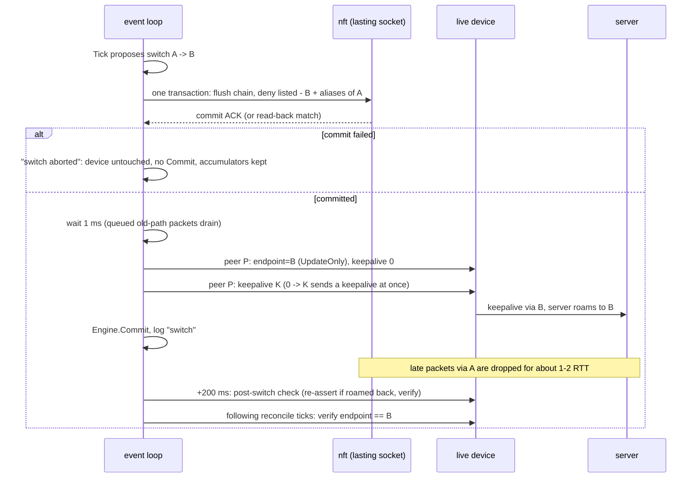

# Switching: nft deny-list and the switch procedure

Code: `internal/nftable` (table, rules, error classification), `internal/wgdev` (endpoint set and kick), `internal/daemon/switch.go` and `reconcile.go`.

## Why a deny-list

WireGuard roams: the live device adopts the source address of any authenticated packet. Right after a switch, packets still in flight on the old path would roam the device back. The daemon therefore drops, on the input hook, UDP packets to the device's listen port from every listed candidate except the selection (plus the aliases of the endpoint just left). Unlisted sources are never denied otherwise, so NAT and relays that reply from another address keep working.

## The table

`table inet <--nft-table>` (default `wgsteer_<device>`) with one base chain `input`, created with the owner flag. Rendered by `nft list table inet wgsteer_wg0` while the daemon runs:

```
table inet wgsteer_wg0 { # progname wgsteer
	flags owner
	chain input {
		type filter hook input priority filter - 5; policy accept;
		udp dport 51820 ip saddr 127.0.0.1 udp sport 4000 counter packets 0 bytes 0 drop
		udp dport 51820 ip saddr 192.0.2.7 udp sport 443 counter packets 0 bytes 0 drop
		udp dport 51820 ip6 saddr ::1 udp sport 5000 counter packets 0 bytes 0 drop
		udp dport 51820 ip6 saddr 2001:db8::1 udp sport 51820 counter packets 0 bytes 0 drop
	}
}
```

- One rule per denied tuple: `udp dport <listen port> ip|ip6 saddr <addr> udp sport <port> counter drop`. The expressions match what `nft` itself generates, so listings render exactly this way.
- **`udp dport <listen port>` is mandatory.** The probe runs on the same host and receives replies from every candidate on its own port; a rule without the dport match would kill the probe.
- Rules are sorted: IPv4 first, then by address and port. Each carries a userdata TLV (type `0xd7`, `wgsteer <port> <addr:port>`) that identifies it on read-back; `nft` ignores unknown TLV types, so listings show no comment.
- The input hook covers packets after routing/NAT and loopback-delivered relays (`127.0.0.1:port`). `drop` is final across tables, so another table's `accept` does not undo it.
- Per-tuple counters show late-packet drops per switch (`drops_before` in the switch log, `deny_packets`/`deny_bytes` in the snapshot).

### Denied set

`nftable.Desired(listed, selected, aliases, listenPort)`:

- denied = (listed − selected) ∪ aliases, normalized and deduplicated;
- the selection is never denied, even if it also appears among the aliases;
- no selection (zero) denies every listed endpoint;
- `Ruleset.Equal` compares the denied tuples as a set; two empty rulesets are equal whatever their ports (both mean an empty chain).

| State | Denied |
|---|---|
| Normal | listed − selection, plus the aliases the last switch left |
| Startup on an unlisted endpoint (or none) | every listed endpoint; the device's unlisted endpoint stays allowed |
| After a reload removed the selection, until the reload switch | listed − removed selection (it stays allowed) |
| After the reload switch | listed − new selection, plus the removed selection |
| Unlisted denied tuple still delivering after the switch settled | Released: it becomes an alias of the new selection (see [Aliases](#aliases)) |

### Owner flag

- The table is created with `NFT_TABLE_F_OWNER` over a single lasting netlink connection (`nftables.New(nftables.AsLasting())`) that lives as long as the process. The kernel deletes an owned table as soon as its owning socket closes: clean exit, SIGKILL, panic, OOM kill.
- While the daemon runs, `nft list` shows `flags owner` and `# progname`; `nft delete table` from another process fails with `Operation not permitted`; `nft flush ruleset` (also `nft -f` files starting with it) skips the owned table and returns 0.
- Every operation goes through that one connection. A second connection cannot modify the table (`EPERM`).
- At start, an existing **unowned** table with the same name is stale and is deleted inside the creation transaction (`replaced_stale=true`). A table **owned by another live socket** means a second instance for the device: startup fails (`nft table owned by another process … another instance manages <device>`). A kernel without owner support fails startup with `kernel does not support nft owner-flag tables (needs Linux >= 5.12)`; there is no unowned fallback.
- **Updates** (startup, switch, listen-port change, reload, retry) are one atomic transaction: read the counters, flush the daemon's chain, add the complete rule list. Nothing else is touched.
- **Stop** deletes the table explicitly, then closes the connection.

## Error handling

`Manager.Apply` returns nil only when the rules are known to be in force (ACK, or read-back after an unknown outcome). A failed transaction is rejected by the kernel as a whole; the previously committed rules stay in force and the lasting socket stays open, so **an nft error never means the table is gone**.

| Error | Cause | Daemon action |
|---|---|---|
| `ErrRejected` (`nft transaction rejected`) | Kernel error reply for the batch, or a read-back after an unknown outcome shows the old rules | Keep the connection; `Committed()` is in force; mark dirty; retry on the next reconcile tick (`nft rebuild reason=retry`). During a switch: abort |
| `ErrUnknown` (`nft transaction outcome unknown`) | Receive error that is not a kernel reply (e.g. `ENOBUFS`) and reading the chain back failed | Same as rejected |
| `ErrConnBroken` (`nft netlink connection broken`) | Send-level socket error, or 3 consecutive failed read-backs (counter reads, verification) | `Reconnect(desired)`: `CloseLasting()` first (the kernel drops the table; the device roams freely until the rebuild), then a new lasting connection, recreate the table, apply the desired rules; log `nft reconnect`. If table creation fails, the manager has no connection, every call returns `ErrConnBroken`, and the next apply reconnects again |
| `ErrOwnedElsewhere`, `ErrNoOwnerSupport` | Startup only | Refuse to start (exit 1) |
| `ErrClosed` (`nft manager closed`) | Use after `Close` | n/a |

Rules:

- Never open a second connection to recover. It cannot modify the owned table, and the old socket would keep stale rules alive. Replacing the connection always starts with `CloseLasting()`.
- An outcome is unknown only for non-kernel receive errors; it is resolved by reading the chain back over the same connection and comparing it with the desired rules (exact expressions, userdata and order).
- A failed counter read logs `nft error op=counters` and marks the rules dirty, which forces a re-apply on the next reconcile tick.
- During a switch, a broken connection is rebuilt with the **pre-switch** desired rules, and the switch is aborted.

## Switch procedure



1. **Block first.** Build the desired rules for target B (the endpoint being left and its aliases become denied) and commit them; wait for the ACK. Then wait 1 ms before step 2: old-path packets the input hook accepted before the commit may still be queued in kernel WireGuard's asynchronous receive path, and processing them after step 2 would roam the device back. `block_set_gap_ms` (ACK to the end of step 3) is therefore about 1.1 ms; old-path packets arriving meanwhile are dropped by the new rules.
   - Commit failed: abort. The device is not touched, the selection and the old rules stay, the decision record is logged as `switch aborted` (warn), and the engine is not committed, so a later tick proposes the switch again.
2. **Set** the endpoint with `UpdateOnly` on the managed peer only. Keys, allowed IPs and other peers are never touched.
3. **Kick** (`--kick`, default true), with the peer's original keepalive K:
   - K > 0: `{endpoint, keepalive 0}`, then `{keepalive K}`;
   - K = 0: `{endpoint, keepalive 0}`, then `{keepalive 1s}`, then `{keepalive 0}`.

   The 0→nonzero transition makes WireGuard send a keepalive at once through the new endpoint, so the server roams there even when the client is idle. Both branches start at keepalive 0, so the transition also happens when a failed earlier kick left 1 s behind. It needs the interface to be up. `--kick=false` sets only the endpoint.
4. **Commit** the engine (selection, cooldown, accumulator reset, restore level). If setting the endpoint failed after the nft commit, the switch still commits with result `set-failed` (`switch set endpoint failed` is logged); the rules already deny the old path and reconcile finishes the write (see the pending-write row below).
5. **Verify:** 200 ms after the switch the daemon runs an extra reconcile (the post-switch check, `post-switch check` at debug). If late packets still roamed the device back (to A or one of its aliases, all denied), it is re-asserted at once (`re-assert`) instead of on the next reconcile tick. That read and the following reconcile ticks verify: the device endpoint equals B and no endpoint write is pending → `switch verified` (warn if the managed peer's last handshake changed, i.e. the switch was not transparent); not within 3 reads → `switch not verified` (`write_pending` says whether the write was still unfinished).

Switch results in the snapshot history: `ok`, `set-failed`, `aborted`, `dry-run`.

## Reconcile

Every `--reconcile-interval` the daemon reads the device with wgctrl (no change notifications exist) and applies, in order:

| Observed | Action |
|---|---|
| Device or managed peer missing, no key/peers, or read error | `detached`: keep probing, leave nft alone, defer switches |
| Device back after detach | Re-validate, `device attached`, mark rules dirty (re-applied on this tick) |
| fwmark changed | `fwmark changed`; copy it to the probe (`SetFwmark`). After any failure (`probe fwmark failed`, warn once, then debug) the probe's socket marks are unknown (IPv4 and IPv6 are set one after the other), so the device's mark is re-applied on every tick until one succeeds, even if it returned to the last value that worked. The probe re-applies the mark to its sockets itself, because wireguard-go records a new mark before applying it and skips an identical one |
| Listen port changed (device recreated) | `listen port changed`; rebuild the rules with the new port (`nft rebuild reason=listen-port`), then the endpoint check below re-asserts if needed |
| Committed rules ≠ desired, or dirty | Re-apply (`nft rebuild reason=retry`) |
| An endpoint write (switch or re-assert) failed | **Pending write**: `wgdev.SetEndpoint` is several netlink calls, so the device may already show the target with the kick's temporary keepalive (0, or 1 s when the original is 0). The whole write is redone toward the selection with the **original** keepalive on every tick until it succeeds (`endpoint write resumed`; `endpoint write retry failed` warns on the first failed retry, then debug), even when the endpoint already matches. A tick that redid the write skips the rows below (no re-assert, no alias learning, no verification): the endpoint is judged, and the switch verified, only on a later read. The original keepalive is used for every write until a read shows it restored. A keepalive that is neither the original nor the temporary value means the device was reconfigured: `endpoint write superseded`, and its configuration wins |
| Endpoint == selection | Nothing |
| Endpoint is listed but not selected, or empty (netifd/wg-quick reset, manual `wg set`) | **Re-assert** at once: set the selection again with a kick (per `--kick`), `re-assert`. Not a switch: no cooldown, at most once per tick. nft already denies the observed endpoint |
| Endpoint is the selection removed by a reload | Nothing; it stays allowed until the reload switch |
| Endpoint is unlisted and currently denied (an alias of a selection the device left) | Late packets roamed the device back: **re-assert**, like a listed endpoint; never learned as an alias of the new selection |
| Endpoint is unlisted (otherwise) | Record it as an **alias** of the selection (`alias learned`); never deny or fight it |
| Last handshake older than 180 s (or none) while the selection probes fresh | `device handshake stale` once per episode: a device problem switching cannot fix |

In dry-run, an endpoint that differs from the simulated selection is only logged at debug.

Roaming can never move the device to a listed, non-selected candidate while the rules match, so that state always means an explicit external change.

## Aliases

An alias is an unlisted endpoint observed on the device: NAT on the path, or a relay replying from a different address than the one contacted.

- While S is selected, an unlisted endpoint U seen on the device is S's alias. It is never denied and never re-asserted (that would loop). Decisions use S's score.
- On switching away from S, S **and** its aliases are denied until the next switch, so in-flight packets from U cannot roam the device back.
- Aliases stay denied until the next switch even if packets from them keep arriving: the drop counters see unauthenticated UDP, and a lost kick can keep the server sending via the old path for up to a keepalive interval. Releasing them early would let the device roam back and undo the switch.
- The next switch rebuilds the denied set from scratch: listed − new selection, plus the aliases of the endpoint just left. An alias of the direct path is unblocked again when the direct path is selected later.
- Startup on unlisted U (no selection): all listed candidates are denied and U stays allowed. The startup switch has no previous selection whose aliases it could retire, so U stays allowed after it too. If the device keeps using U (e.g. it started on a relay's alias and the startup switch went to that relay), reconcile learns U as the new selection's alias; switching away from that selection later denies it.
- An alias that becomes listed through a reload is an ordinary candidate from then on.
- Aliases are learned only by observation: an alias of a non-selected candidate that was never seen on the device is not denied.

## Listen port and fwmark

- **Listen port:** never assumed fixed. Every rule carries the current `udp dport`; a change seen by reconcile rebuilds the table. Until that tick, the old rules match nothing and roaming is unrestricted (harmless).
- **fwmark:** the probe starts with the device's fwmark and follows every change. Without it, wg-quick-style full tunnels (`not fwmark X` → table with the default route via the device) would route the probe's outer packets into the device, and the probe would measure tunnel-in-tunnel. A nonzero mark sets `SO_MARK` on both probe sockets and needs `CAP_NET_ADMIN`. The probe config must not set `fwmark` (parse error: `fwmark is copied from the live device; remove it`).
