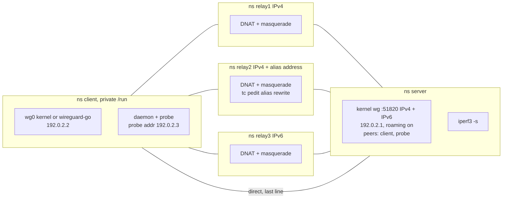

# Testing

| Layer | Where | Privileges | Command |
|---|---|---|---|
| Unit and simulation | every package | none | `make test` (or `go test ./...`) |
| Probe loopback integration | `internal/probe/integration_test.go` | none (loopback, IPv4 and IPv6) | part of `go test ./...` |
| Privileged Go tests | `internal/nftable/privileged_test.go`, `internal/wgdev/privileged_test.go`, `internal/probe/bind_linux_test.go` | `CAP_NET_ADMIN` in a user+network namespace | `make integration` (nftable, wgdev) |
| Namespace suites | `tests/integration/test_topology.py`, `tests/integration/test_daemon.py` | unprivileged user namespace | `python3 tests/integration/<file> -v` |

`make integration` builds the binary, downloads every module in `go.mod` (the namespace suite builds wireguard-go with `GOPROXY=off`), runs the nftable and wgdev test binaries under `unshare -rn` (each binary is removed afterwards, the exit status kept), then `python3 tests/integration/test_daemon.py -v`.

## Unit tests (no privileges)

| Package | Covers |
|---|---|
| `endpoints` | Parsing, bracketed IPv6 canonicalization, rejections (hostnames, zones, link-local, mapped, port 0, duplicates after normalization), error names the line, `FromUDPAddr` unmapping |
| `probecfg` | Hex keys, exactly one peer, public-key derivation, default `allowed_ip`, `UAPI` text, rejection of a probe identity equal to the device identity |
| `probe` | ICMP/ICMPv6 checksums and header building; replies with a wrong id, seq, nonce or source ignored; channel TUN stamping, filtering, queue limits; scheduler round-robin, reload continuation, late replies stay losses, invalid slots, session validity; `udpBind` alternating families, lifecycle, endpoint parsing |
| `stats` | Ring order and eviction, decay weights and n_eff, prior and loss SE, weighted RTT, infinite cost without replies, `skipNewest` |
| `policy` | `TestCalibration` (S1–S10, S4′), `TestTargets` (seeded simulation), and the state machine on a fake clock: accumulator flicker, freshness only at switch time, retry without `Commit`, gated comparison, cooldown for all kinds, adaptive outage K, outage after an all-down recovery (common-mode losses ignored, `outage-unconfirmed` wait keeps state, a genuine outage still switches at the K-th loss), revert tie and backoff, all-down, unlisted start, reload, time-gap reset, single endpoint, decision JSON, blocker reasons |
| `nftable` | `Desired` (selection, none, aliases, both families), `Ruleset.Equal`, userdata round trip, error classification, read-failure threshold on a fake netlink socket |
| `status` | JSON with infinite costs, one text row per record |
| `daemon` | Flag parsing and validation; startup privilege check (effective-capability rendering, `CAP_NET_ADMIN` required); with fake device, nft and probe: switch blocks then sets, abort keeps state and retries, re-assert once per tick, aliases denied only after switching away, startup on an unlisted endpoint (all listed denied; the startup switch keeps the start endpoint allowed, learns it as the new selection's alias, and denies it when switching away from that selection), listen-port rebuild, fwmark reaches the probe, detach, dry-run never writes, reload removing the selection, snapshot completeness, foreign peer rejected; watchdog fires on a stall and not on a slow-but-alive loop |

The simulation runs hours of simulated time in seconds; `go test -short ./internal/policy/...` runs a quarter of the seeds. The loss 5% → 50% subtest skips by design with its measured values ([scoring.md](scoring.md#the-unmet-50-loss-tail)). Results: [scoring.md](scoring.md#behavioral-targets-testtargets). `TestSimParams` runs the same scenarios with the parameters in `WGSTEER_SIM_PARAMS` and only prints measurements; it skips without the variable and is driven by `tools/tune.py sim` ([scoring.md](scoring.md#tuning-on-recorded-data)).

## Probe loopback integration

`internal/probe/integration_test.go`, no privileges, scaled to a 60 ms interval and 40 ms timeout:

- server: a second wireguard-go device (roaming on) over a channel TUN with an ICMP echo responder;
- relays: Go UDP forwarders on loopback with per-relay delay, loss and blackhole;
- the probe under test on the same loopback.

| Test | Asserts |
|---|---|
| `TestIntegrationRTTAndLoss` | Per-relay RTT tracks the injected delay; loss is attributed to the right relay |
| `TestIntegrationLateReplyDoesNotRoam` | A reply delayed beyond the timeout counts as a loss for its own relay and does not move the probe's endpoint (`IpcGet` `endpoint=`); a control with roaming left on does move it. Guards the upstream no-roam behavior against wireguard-go upgrades |
| `TestIntegrationBlackholeSessionSurvives` | With one relay blackholed, the session survives via the others |
| `TestIntegrationMixedFamilies` | IPv4 relay, dead IPv6 endpoint, IPv4 relay, `::1` relay in sequence (end-to-end check for the bind workaround; `TestUDPBindAlternatingFamilies` is the dependable regression test) |

Every test starts with a startup phase: slots run until the first valid sample, and every slot before it must be invalid (a probe without a session is never a loss).

Under `unshare -rn` the loopback interface must be up, otherwise these fail with "network is unreachable". `TestUDPBindAlternatingFamilies` and `TestIntegrationMixedFamilies` send one packet per round to the RFC 6666 discard prefix (`100::/64`); on a host with an IPv6 default route it leaves the machine and is dropped.

## Privileged Go tests

They skip with a message unless running with `CAP_NET_ADMIN` in a non-initial user namespace (and need the `nft` / `ip` binaries). Run them via `make integration`, or by hand:

```sh
go test -c -o .nftable.test ./internal/nftable && unshare -rn ./.nftable.test -test.v; rm -f .nftable.test
go test -c -o .wgdev.test ./internal/wgdev && unshare -rn ./.wgdev.test -test.v; rm -f .wgdev.test
```

| Test | Asserts |
|---|---|
| `TestPrivRuleEncodingAndDrops` | Exact `nft list` rendering of the rules; a real datagram from a denied tuple is dropped while another source port passes; the counter reads 1 and `Apply` returns it as `before` |
| `TestPrivForeignConnection` | A second connection gets `EPERM` modifying the table; `nft delete` fails; a second `Open` gets `ErrOwnedElsewhere` |
| `TestPrivFailedTransaction` | A valid change plus a rule for a nonexistent chain returns `ErrRejected` (`ENOENT`); the table is still owned by this process, the rules are exactly the previous set, and the next `Apply` succeeds on the same connection |
| `TestPrivUnknownOutcome` | A faked `ENOBUFS` after a committed batch returns nil (read-back match); after a rejected batch, `ErrRejected` |
| `TestPrivReplacement` | `CloseLasting` removes the table; `Reconnect` recreates it, owned, with its rules |
| `TestPrivStaleTable` | An unowned table of the same name is replaced in one transaction |
| `TestPrivFlushRulesetSkipsOwnedTable` | `nft flush ruleset` and `nft -f` with `flush ruleset` exit 0 and leave the table |
| `TestPrivProcessDeath` (with `TestPrivHelperOwner`) | A child process owns the table; while it lives `Open` gets `ErrOwnedElsewhere`; after SIGKILL the table is gone |
| `TestPrivKernelDevice` (wgdev) | Two kernel devices over loopback: `Get` fields, `ErrNotFound`, endpoint-only update leaves keys/allowed IPs/handshake untouched, the kick sends exactly one 32-byte keepalive for K = 25 and K = 0 and restores K |

`TestUDPBindSetMark` (`internal/probe`) needs `CAP_NET_ADMIN` for `SO_MARK` and skips otherwise: `go test -c -o probe.test ./internal/probe && unshare -rn sh -c 'ip link set lo up && ./probe.test -test.run TestUDPBindSetMark -test.v'`. The whole probe package also passes this way.

## Namespace suites

Python `unittest` in `tests/integration/`: `framework.py` (user namespace setup, `NetNS`, `ManagedProcess`), `topology.py` (the topology and helpers), `test_topology.py` (harness self-test without the daemon), `test_daemon.py` (daemon scenarios). Each test program first calls `setup_userns()`, which maps the current user to root in a new user and network namespace; every node is a further network namespace.

### Topology



| Path | Endpoint (defaults) | Notes |
|---|---|---|
| `relay1` | `10.231.1.1:40001` | |
| `relay2` | `10.231.2.1:40002` | alias endpoint `10.231.2.11:40002` (reply-source rewrite on demand) |
| `relay3` | `[fd00:231:3::1]:40003` | IPv6 |
| `direct` | `10.231.0.1:51820` | the server itself, last line |

- Each path has its own veth pairs on both sides and a netem qdisc per direction (`Topology.set_path`: delay, jitter, distribution, loss, blackhole, two-point "spike" tables). Values apply per direction, so a round trip over both directions adds twice the delay.
- Device `wg0`, nft table `wgsteer_wg0`, fwmark variant `51820` with wg-quick-style policy routing.
- Generated per run in a fresh `/tmp/wgsteer-it-*` directory: `probe.conf` (UAPI hex), `endpoints` (the four paths in order), keys, netem tables.
- Address prefixes, ports and the binary are configurable through `WGSTEER_V4_PREFIX`, `WGSTEER_V6_PREFIX`, `WGSTEER_TUNNEL_PREFIX`, `WGSTEER_SERVER_PORT`, `WGSTEER_RELAY_PORT_BASE`, `WGSTEER_BIN` (default `./wgsteer`), `WGSTEER_WIREGUARD_GO`, `WGSTEER_TC_DIST_DIR`.
- Every daemon runs under `setpriv` with exactly `CAP_NET_ADMIN` (`DAEMON_PRIVILEGES`: inheritable, ambient and bounding sets, noroot securebits, `no_new_privs`), the production capability set; `test_adopt_at_start` asserts the `privileges` line shows `capabilities=cap_net_admin`. The process stays uid 0 of the user namespace, but without capabilities of its own that uid is only a file owner, so this matches a non-root service user for every kernel check.
- Variant: the client's wg0 as wireguard-go, covering wgctrl's userspace path. Built offline from the pinned module with the `StdNetBind` fix of wireguard-go PR #135 applied (see Host quirks): a patched copy of the module replaces it through a temporary `go.work`, so every other dependency stays at the version `go.mod` selects; the build checks that `go.mod`/`go.sum` stay unchanged. `WGSTEER_WIREGUARD_GO` bypasses the build and the fix.

### Scaled flags

`Topology.start_daemon()` passes the five required flags plus `SCALED_FLAGS` (overridable per test; `None` drops a flag):

| Flag | Value |
|---|---|
| `--probe-interval` | `100ms` |
| `--probe-timeout` | `60ms` |
| `--history` | `50` |
| `--half-life` | `15` |
| `--min-samples` | `10` |
| `--margin-abs` | `2ms` |
| `--persist` | `2s` |
| `--cooldown` | `3s` |
| `--wait-to-restore` | `6s` |
| `--watchdog` | `2s` |

With 4 endpoints each one gets a sample every 0.4 s. History 50 and half-life 15 keep a window of a few half-lives like the production defaults (267/60), and min-samples 10 is two thirds of a half-life (production: 20 of 60). `--margin` stays at the default; switch assertions read it from the daemon's `config` line. `--margin-abs` scales with the cost level: harness paths cost about 20 ms where production assumes 150–200 ms, so 10 ms would demand a 50% effect and block every degradation switch. `--watchdog` must be at least twice the 1 s reconcile interval. `Topology.build` resolves ARP/NDP on every underlay hop before shaping, otherwise each path's first probe sample would be one RTT late.

### Running

```sh
make build
python3 tests/integration/test_topology.py -v
python3 tests/integration/test_daemon.py -v
```

`test_topology.py` proves the harness without the daemon: per-path pings, netem on one path only, jitter and spike tables, blackhole and loss, relay2 alias rewrite, IPv6 path, fwmark variant, wg0 recreation, parsing an owner-flag table, the process wrapper, the userspace variant, and the **negative control**: under load, a plain `wg set` to another relay is undone by roaming (the problem the deny-list solves).

### Daemon scenarios (`test_daemon.py`)

Every test builds a fresh topology and runs its own daemon(s). All paths carry a 10 ms per-direction base delay (20 ms RTT); degradations shape the client → server direction unless stated, so a round trip sees exactly the stated loss or delay. Bounds are formulas over the effective timing (`Timing`: slot, N endpoints, P = N × slot, persist, cooldown, wait-to-restore). Scenarios whose degraded RTT exceeds the 60 ms probe timeout (+60 ms shift, 100 ms spikes) run with `SLOW_FLAGS`: interval 200ms, timeout 150ms, persist 4s, cooldown 6s, wait-to-restore 12s.

| Test | Asserts |
|---|---|
| `test_adopt_at_start` | wg0's listed endpoint is adopted; the table has dport = wg0's port and denies every other listed endpoint; no switch while paths are equal |
| `test_loss_degradation` | 40% loss on the active path: degradation switch to the best path within the bound. Runs with `--outage-epsilon=1e-30`, which pins K at 10 so the outage rule cannot pre-empt the degradation rule |
| `test_latency_shift` | +60 ms on the active path: switch |
| `test_jitter_routing_change` | 30% of packets +100 ms (median unchanged): switch |
| `test_not_significant` | Active 10% slower and 1% lossier: no switch, no flapping |
| `test_revert_under_background_loss_5pct` / `_10pct` | Daemon starts on #1 (relay2), #0 equal, 5% / 10% loss on every path: `restore` to #0 within [WTR − slot, 1.5 × WTR] after both are eligible |
| `test_cooldown` | Degrading the new active right after a switch: the next switch waits for the cooldown |
| `test_outage` | Blackhole the active path: outage switch within K × N × interval + slack |
| `test_all_down` | Blackhole every path, then heal all at once: no switch (common-mode losses must not trigger an outage switch) |
| `test_high_load_transparency` | iperf3 (TCP, both directions) through wg0 while ≥ 3 switches are forced by alternately delaying the active path: wg0 stays on each target (sampled every 100 ms), the old path's deny counter rises briefly then stops, every switch is verified, the handshake never changes, no 1 s iperf3 interval at 0 bit/s |
| `test_external_reset` | `wg set` to the direct endpoint: re-asserted within about one reconcile interval |
| `test_listen_port_change` | wg0 recreated on a new port: table rebuilt with the new dport, selection re-asserted |
| `test_unlisted_alias` | relay2 replies from its alias: wg0 on the alias is not fought; switching away denies it and the switch sticks |
| `test_unlisted_at_start` | wg0 starts on relay2's alias: every listed endpoint denied and the alias allowed, then a startup switch once a candidate is eligible; the switch does not deny the alias, and when the target is relay2 (which answers from the alias) wg0 moves to the alias and the daemon learns it as relay2's alias without fighting it |
| `test_ipv6` | v4 → v6 → v4 switches; IPv6 rules work; endpoints normalized |
| `test_post_switch_reassert` | Right after an outage switch, wg0 is put back on the endpoint just left (emulating late old-path packets roaming it back); with a 5 s regular reconcile interval, the post-switch check (logged at debug) must re-assert the target within 200–350 ms and wg0 must read back on it |
| `test_reload` | `SIGHUP` without the selected endpoint: immediate switch; adding one: it gets probed |
| `test_fwmark` | wg-quick-style fwmark routing: the probe copies the fwmark and measures the relay paths |
| `test_clean_stop` | `SIGTERM`: table removed, wg0 keeps its endpoint, exit code 0 |
| `test_sigkill_and_restart` | `SIGKILL`: the table disappears without a restart and wg0 keeps working; restart creates one table and adopts the selection |
| `test_second_instance` | A second daemon on the same device refuses to start; the first keeps working |
| `test_foreign_flush` | `nft flush ruleset` and `nft -f` starting with it: both exit 0; the table and rules survive |
| `test_stale_unowned_table` | A hand-made unowned table of the same name is replaced by the owned one |
| `test_dry_run` | Degrading the active path logs `would switch`; no table; wg0 untouched |

`KernelDaemonTest` runs all 25 with kernel wg0; `UserspaceDaemonTest` reruns `test_adopt_at_start`, `test_loss_degradation`, `test_external_reset`, `test_ipv6` and `test_clean_stop` with wireguard-go as wg0. A full run takes about 6 minutes. Measured numbers are printed to stderr as `[metric] <test>: name=value (bound ...)`. A failing test prints the tail of each daemon log and keeps the full logs in a temp directory; `WGSTEER_LOG_DIR=<dir>` keeps the logs of every test.

- Eligibility waits allow two WireGuard handshake retries (`REKEY_TIMEOUT`, about 5.3 s each): if the probe's first handshake is lost on a lossy path, its slots stay invalid until the next retry.
- A persistent-keepalive change from one non-zero interval to another only takes effect at wg0's next packet (the armed timer keeps the old interval); enabling it from 0 sends a keepalive at once. `Topology.wg_set_keepalive` therefore goes through 0. Otherwise wg0 stays silent until its passive keepalive (10 s after the last data it received) or the old interval, and under upstream loss the server can hit its 15 s new-handshake deadline (`KEEPALIVE_TIMEOUT` + `REKEY_TIMEOUT` after its last data) and re-handshake on its own.

### Host requirements

- Unprivileged user namespaces enabled; `/dev/net/tun` accessible (wireguard-go variant).
- Kernel WireGuard, nftables, veth, `sch_netem`, clsact/flower/pedit available inside a user namespace.
- Tools: `ip`, `nft` (≥ 1.1.0, see below), `wg`, `tc`, `ping`, `iperf3`, `sysctl`, `setpriv` (util-linux), `go`, Python 3.
- No qemu: everything runs in unprivileged namespaces.

### Host quirks

- **nft payload mangling is not permitted in a user namespace** (`ip saddr set`, `udp sport set` fail with `EPERM`; `meta mark set` works). relay2's alias rewrite therefore uses tc (clsact egress with flower + pedit + csum, after NAT).
- **nft 1.0.9 (Ubuntu 24.04) corrupts a single table flag in JSON output.** For a table with only `flags owner`, `nft -j list tables`/`list table` print a freed string (`"flags": "t"`, the release name, or bytes that are not JSON). The harness reads table flags from `nft -j`, so every owner-flag assertion fails. Fixed upstream by "json: fix use after free in table_flags_json()" (b04512cf), first released in 1.1.0; 1.1.6 (Ubuntu 26.04) prints `"flags": ["owner"]`.
- **Ubuntu 26.04 confines `/usr/bin/wg` with AppArmor** (`/etc/apparmor.d/wg`): key files are readable only under `/etc/wireguard`, so `wg set … private-key /tmp/wgsteer-it-*/…` fails with `fopen: Permission denied`. Unload the profile for the suite: `sudo apparmor_parser -R /etc/apparmor.d/wg`. Ubuntu also withholds capabilities in unprivileged user namespaces until `kernel.apparmor_restrict_unprivileged_userns=0`.
- **tc reads netem distribution tables only from its compiled-in directory** (iproute2 7.2 on Arch: `/usr/share/tc`, `TC_LIB_DIR` only affects plugins; Debian and Ubuntu: `/usr/lib/<multiarch>/tc`). Every namespace bind-mounts a private table directory over it (`WGSTEER_TC_DIST_DIR` overrides the source). The harness always passes an explicit table with jitter, because netem keeps the old table when a change omits one.
- **New namespaces start with `rp_filter=1`.** The fwmark variant needs wg-quick's conntrack mark save/restore table (`table ip wg-quick-wg0`). wg-quick's `suppress_prefixlength 0` rule is left out on purpose: the relays are on directly connected subnets, so it would let unmarked packets bypass wg0.
- **`/run/wireguard` does not exist on the host and `/run` is not writable** from the user namespace; the client node gets a private mount namespace with a tmpfs on `/run`.
- **The pinned wireguard-go's `StdNetBind` corrupts IPv6 destinations** after an IPv4 send ([caveats.md](caveats.md#upstream-wireguard-go-bind-bug)). A userspace wg0 switched from an IPv4 to an IPv6 endpoint loses one send per pooled address last used for IPv4 (`sendmmsg: network is unreachable` in its log). `sync.Pool` keeps addresses per scheduler P, so these losses can land seconds after the switch and warm-up pings do not reliably reach every pooled address. Unpatched, the userspace tests that switch to relay3 lost pings in `assert_traffic` (with relay3 forced as the target: 7 of 10 runs of `test_loss_degradation`/`test_clean_stop`). The harness therefore builds its wireguard-go with the upstream fix (`_WGGO_BIND_FIX` in `topology.py`); the build fails when the patch no longer applies, which is the signal to drop it after pinning a fixed version.

## CI

`.github/workflows/ci.yml` on GitHub Actions with the latest stable Go. `test` and `integration` run natively on linux/amd64 (`ubuntu-26.04`) and linux/arm64 (`ubuntu-26.04-arm`); the release jobs cross-compile on `ubuntu-latest`. Checkouts fetch the full history and tags so `go build` stamps the version.

| Trigger | Jobs |
|---|---|
| Push to `master`, pull request | `test`: `make test`, `make build`, `./wgsteer --version`. `integration`: host preparation (below), then `make integration` (about 7 minutes) |
| Push of a `v*` tag | `test`; then `build` per GOARCH (`amd64`, `arm64`, `mips64` with `GOMIPS64=softfloat`): `make build`, check that the stamped version equals the tag, pack `wgsteer-<tag without v>-linux-<GOARCH>.tar.gz` (a directory of the same name with `wgsteer`, `LICENSE`, `README.md`); then `release`: a GitHub pre-release from the tag with every tarball and generated notes. `integration` does not run on tags and does not gate releases |

`integration` host preparation: install `iperf3`, `nftables`, `wireguard-tools`; set `kernel.apparmor_restrict_unprivileged_userns=0`; unload the AppArmor profile for `wg`; `modprobe` wireguard, veth, tun, nf_tables, sch_netem, sch_ingress, cls_flower, act_pedit and act_csum (see [Host quirks](#host-quirks)). No 32-bit targets: [caveats.md](caveats.md#no-32-bit-builds).
